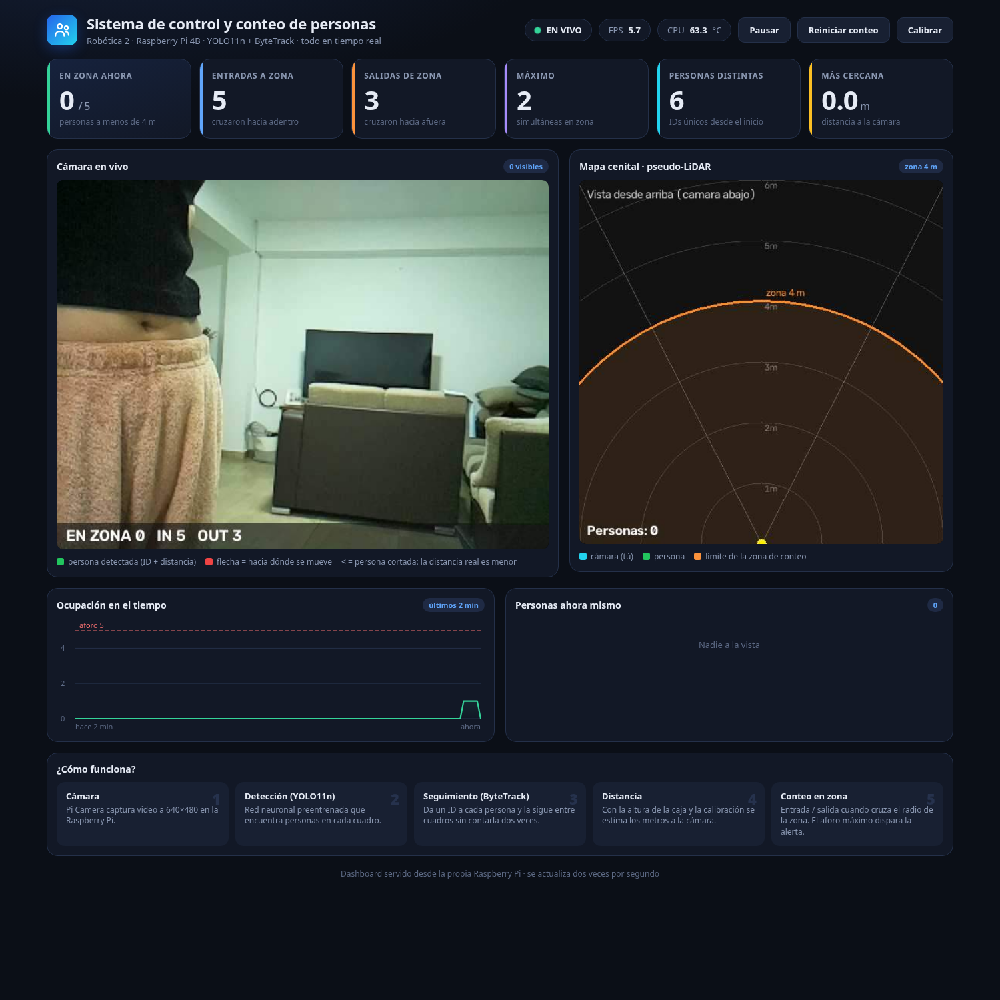

# 👥 Sistema de control y conteo de personas — Robótica 2

> Una **cámara + Raspberry Pi 4B** detecta personas en tiempo real, les asigna un ID, calcula a qué **distancia** están, cuenta cuántas **entran y salen de una zona** y lo muestra todo en un **dashboard web** con un mapa visto desde arriba (estilo LiDAR, pero sin LiDAR).



## ✨ Qué hace
| Función | Cómo |
|---|---|
| 🔍 Detecta personas | YOLO11n (red neuronal ya entrenada, **no entrenamos nada**) |
| 🆔 Las sigue con un ID | ByteTrack (la misma persona mantiene su número) |
| 📏 Estima la distancia | Altura de la caja en la imagen + calibración (modelo *pinhole*) |
| 🎯 Cuenta entradas / salidas | Zona circular de 4 m alrededor de la cámara |
| 🗺️ Mapa cenital "pseudo-LiDAR" | Dibuja a cada persona vista desde arriba |
| 🚨 Alerta de aforo | Se pone en rojo si hay más de 5 personas en la zona |
| 🌐 Dashboard web | Se abre desde cualquier celular o laptop en la misma red |

## 🚀 Lo mínimo que tienes que saber (versión de 30 segundos)
```bash
# 1. Enciende el hotspot "Yafer" del celular (2.4 GHz) y conecta tu laptop a él
# 2. Conecta la Raspberry Pi a la corriente (powerbank 5V/3A) y espera ~2 minutos
# 3. Abre en el navegador:
http://pi-conteo.local:5000
# 4. Para entrar a la Pi por terminal:
ssh pi@pi-conteo.local
# 5. Para apagarla bien (SIEMPRE antes de desenchufar):
ssh pi@pi-conteo.local "sudo poweroff"
```
👉 El detalle paso a paso, con todo explicado, está en **[docs/00_GUIA_PASO_A_PASO.md](docs/00_GUIA_PASO_A_PASO.md)**.

## 📚 Documentación (léela en este orden)
| # | Documento | Para qué sirve |
|---|---|---|
| 0 | [00 · Manual de uso](docs/00_GUIA_PASO_A_PASO.md) | **Encender, conectarse por SSH, usar el dashboard, apagar.** Empieza aquí |
| 1 | [01 · Conceptos para estudiar](docs/01_resumen_y_conceptos.md) | Teoría: YOLO, tracking, homografía, pinhole… lo que te preguntarán |
| 2 | [02 · Código explicado](docs/02_codigo_explicado.md) | Qué hace cada archivo y cada parte importante |
| 3 | [03 · Comandos, SSH y redes](docs/03_comandos_ssh_y_redes.md) | Chuleta de comandos y cómo cambiar de WiFi |
| 4 | [04 · Calibración y pruebas](docs/04_calibracion_y_pruebas.md) | Cómo calibrar la distancia y tablas de pruebas |
| 5 | [05 · Guion de demo y preguntas](docs/05_guion_demo.md) | Cómo presentarlo y qué responder |
| 6 | [06 · Solución de problemas](docs/06_solucion_de_problemas.md) | Si algo falla, qué hacer |
| 7 | [07 · Trabajo en equipo y GitHub](docs/07_equipo_y_github.md) | Cómo clonar, actualizar y no subir contraseñas |

## 🧱 Estructura del repositorio
```
conteo-personas/
├── src/                  ← el programa (Python)
│   ├── main.py           ← orquesta todo (arranque)
│   ├── capture.py        ← lee la cámara
│   ├── detector.py       ← YOLO + ByteTrack
│   ├── mapper.py         ← distancia y mapa cenital
│   ├── counter.py        ← conteo de entradas/salidas
│   ├── motion.py         ← velocidad y flechas
│   ├── server.py         ← servidor web (Flask)
│   ├── dashboard.html    ← la interfaz bonita
│   └── config.py         ← TODOS los parámetros ajustables
├── pi/                   ← scripts para la Raspberry Pi
├── tests/                ← pruebas automáticas de la lógica
├── docs/                 ← documentación e imágenes de prueba
├── referencias/          ← fotos y manual de la Raspberry
├── videos/               ← video de prueba (plan B)
└── requirements.txt
```

## 🧰 Hardware y tecnologías
| Componente | Detalle |
|---|---|
| Computadora | Raspberry Pi 4 Model B, 2 GB RAM, con disipador y ventilador |
| Cámara | Pi Camera OV5647 (campo de visión ≈ 54° horizontal) |
| Energía | Powerbank 5 V / 3 A por USB-C |
| Sistema | Raspberry Pi OS Lite 64-bit (Trixie), usuario `pi`, nombre `pi-conteo` |
| Lenguaje | Python 3 |
| IA | YOLO11n (Ultralytics) exportado a **NCNN** (más rápido en la Pi), ByteTrack |
| Visión | OpenCV |
| Web | Flask + HTML/CSS/JS puro (sin internet) |

## 📊 Resultados medidos
| Métrica | Valor |
|---|---|
| FPS en la Pi | ≈ 5.5 – 6.8 |
| Temperatura trabajando | 47 – 65 °C (sin *throttling*, `get_throttled=0x0`) |
| Prueba de distancia a 3 m (persona de 1.63 m) | midió 3.08 m → **error +2.5 %** (meta < 10–15 %) |
| Latencia de red por hotspot | ≈ 17 ms promedio |

## ⚠️ Limitaciones honestas
- La distancia se estima con la **estatura** supuesta (1.70 m): una persona más alta/baja introduce error proporcional (≈ ±5 % por cada 8 cm).
- Si la persona **sale cortada** del cuadro (muy cerca) la distancia real es *menor* que la mostrada (se marca con `<`).
- Poca luz o personas muy pegadas reducen la precisión.

*Proyecto de Robótica 2.*
