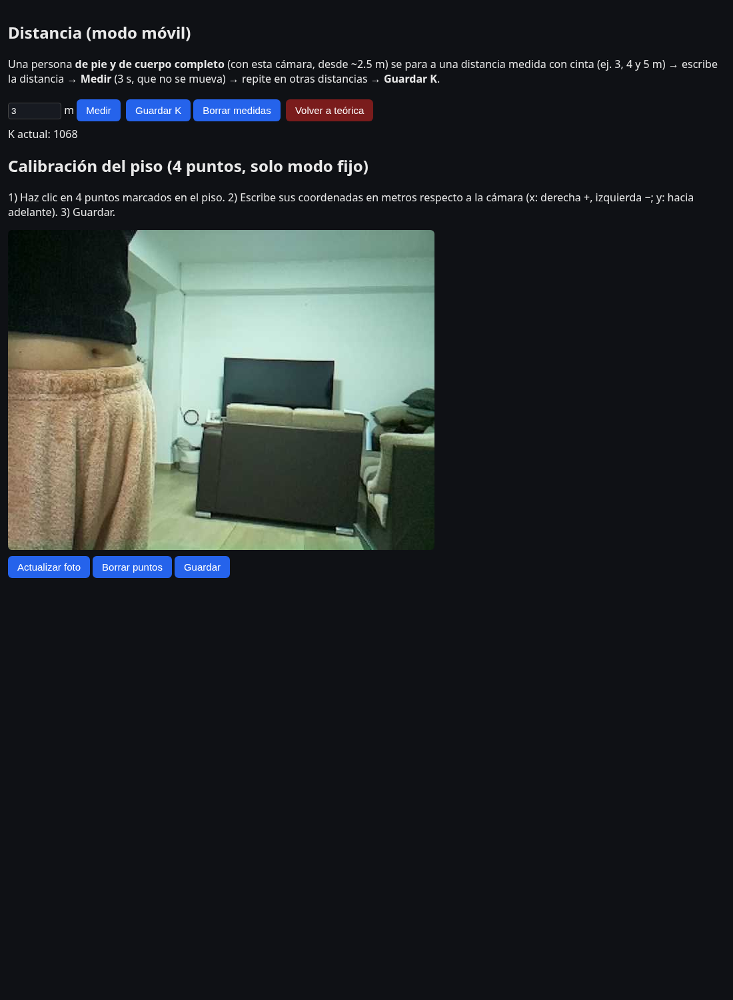

# 00 · Manual de uso paso a paso 📖

> **Objetivo de este documento:** que puedas **encender, usar, apagar y reparar** el proyecto tú solo, sin ayuda de nadie, el día de la defensa.
> Todo lo que está en `bloques de código` se copia y pega en la **terminal**.

---

## 📑 Índice
1. [¿Qué es lo que vas a usar?](#1--qué-es-lo-que-vas-a-usar)
2. [Cómo abrir una terminal](#2--cómo-abrir-una-terminal)
3. [Antes de empezar: seguridad física](#3--antes-de-empezar-seguridad-física)
4. [ENCENDER todo (paso a paso)](#4--encender-todo-paso-a-paso)
5. [Entrar a la Pi por SSH](#5--entrar-a-la-pi-por-ssh)
6. [Usar el dashboard](#6--usar-el-dashboard)
7. [Ver el programa funcionando desde la terminal](#7--ver-el-programa-funcionando-desde-la-terminal)
8. [APAGAR todo correctamente](#8--apagar-todo-correctamente)
9. [Cambiar de red WiFi (casa ↔ universidad)](#9--cambiar-de-red-wifi-casa--universidad)
10. [Calibrar la distancia](#10--calibrar-la-distancia)
11. [Checklist del día de la defensa](#11--checklist-del-día-de-la-defensa)
12. [Plan B si algo falla](#12--plan-b-si-algo-falla)

---

## 1 · ¿Qué es lo que vas a usar?

```
 📷 Cámara ──cinta──▶ 🍓 Raspberry Pi ──WiFi (hotspot)──▶ 💻 Tu laptop / 📱 celular
 (ve a las personas)  (piensa: IA + cuenta)              (ves el dashboard en el navegador)
        ▲
        └── 🔋 Powerbank 5V/3A (la alimenta)
```

| Pieza | Para qué sirve |
|---|---|
| 🍓 **Raspberry Pi 4B** | Es el "cerebro": corre el programa de IA y el servidor web |
| 📷 **Cámara** | Sus imágenes son lo único que "ve" el sistema |
| 🔋 **Powerbank** | La energía. Debe dar **5 V y 3 A** |
| 📱 **Celular con hotspot** | Crea la red WiFi donde se conectan la Pi y la laptop |
| 💻 **Laptop** | Desde aquí ves el dashboard y te conectas por terminal (SSH) |

**Dato importante:** la Pi **no tiene pantalla, teclado ni mouse**. Se maneja de forma remota desde tu laptop. Por eso se usa **SSH** (te permite escribir comandos en la Pi desde tu laptop).

**Otro dato importante:** el programa está configurado para **arrancar solo** cuando la Pi se enciende. No tienes que ejecutar nada para que funcione; solo conectar a la corriente.

---

## 2 · Cómo abrir una terminal

| Tu laptop | Cómo abrir la terminal |
|---|---|
| 🐧 **Linux** | `Ctrl + Alt + T` (o busca "Terminal" / "Konsole") |
| 🪟 **Windows 10/11** | Tecla `Windows`, escribe **PowerShell** y Enter (o clic derecho en inicio → *Terminal*) |
| 🍎 **Mac** | `Cmd + Espacio`, escribe **Terminal** y Enter |

> 💡 En Windows 10/11 y Mac el comando `ssh` **ya viene instalado**. No necesitas PuTTY.

---

## 3 · Antes de empezar: seguridad física

- ⛔ **Conecta y desconecta la cinta de la cámara y la tarjeta SD SOLO con la Pi desenchufada.**
- ⛔ No toques los pines metálicos (GPIO) ni la parte de abajo de la placa con la corriente conectada.
- ⛔ No apoyes la Pi sobre metal ni sobre cables sueltos.
- ⚠️ Los cables **rojo y negro** del ventilador van a los pines GPIO. No los muevas.
- ✅ Agárrala por los bordes.
- ✅ **Nunca desenchufes la Pi "a lo bruto"** mientras trabaja: primero apágala con el comando (sección 8). Si no, se puede dañar la tarjeta SD.

---

## 4 · ENCENDER todo (paso a paso)

### ✅ Paso 4.1 — Enciende el hotspot del celular
1. En el celular: **Ajustes → Zona WiFi / Hotspot**.
2. Nombre de red: **`Yafer`** (exactamente así, con la Y mayúscula).
3. Banda: **2.4 GHz** (no 5 GHz — la Pi llega mejor y más estable).
4. Actívalo. La contraseña es la que tú pusiste (ver tu archivo privado `docs/CREDENCIALES.local.md`).

> 🔒 Las contraseñas **no** están en este repositorio a propósito (ver [07 · Equipo y GitHub](07_equipo_y_github.md)).

### ✅ Paso 4.2 — Conecta tu laptop al hotspot
Conecta la laptop a la red **`Yafer`**. **Debe ser la misma red que la Pi**, si no, no se ven entre sí.

### ✅ Paso 4.3 — Enciende la Raspberry Pi
1. Revisa que la **cinta de la cámara** esté bien puesta (con la Pi apagada).
2. Conecta el cable USB-C de la **powerbank** a la Pi.
3. Se enciende **sola** (no tiene botón). Verás una luz roja fija y una verde parpadeando.
4. **Espera unos 2 minutos.** En ese tiempo: arranca el sistema → se conecta al hotspot → inicia el programa.

```
🔴 luz roja fija      = tiene corriente
🟢 luz verde parpadea = está trabajando / arrancando
```

### ✅ Paso 4.4 — Comprueba que la Pi apareció en la red
Abre una terminal en tu laptop y escribe:

```bash
ping pi-conteo.local
```

**Si responde así, todo bien ✅** (los números pueden variar):
```
64 bytes desde pi-conteo.local (10.194.180.215): icmp_seq=1 ttl=64 tiempo=19.8 ms
```
Para parar el ping: `Ctrl + C`.

**Si dice "Nombre o servicio desconocido"** ❌:
- Espera 1 minuto más y repite.
- Si sigue igual, busca la IP de la Pi en tu celular: *Hotspot → Dispositivos conectados* (aparece como `pi-conteo`). Usa esa IP en lugar de `pi-conteo.local` en todo este manual.
- Más ayuda en [06 · Solución de problemas](06_solucion_de_problemas.md).

### ✅ Paso 4.5 — Abre el dashboard
En el navegador (Chrome, Brave, Firefox…) de tu laptop **o del celular**:

```
http://pi-conteo.local:5000
```
o con la IP: `http://10.194.180.215:5000` (la IP puede ser distinta cada vez).

Debes ver el video en vivo con las personas encuadradas, el mapa y los contadores. **¡Listo, está funcionando!** 🎉

> ⚠️ Escribe `http://` al principio. Es `http`, no `https`. El navegador dirá "No seguro": es normal, es una red local.

---

## 5 · Entrar a la Pi por SSH

**SSH** = "abrir la terminal de la Pi desde tu laptop". Se necesita para apagar, ver registros, cambiar configuración, etc.

### Conectarse
```bash
ssh pi@pi-conteo.local
```
(o `ssh pi@10.194.180.215` con la IP)

**La primera vez** te preguntará algo así:
```
The authenticity of host 'pi-conteo.local' can't be established.
Are you sure you want to continue connecting (yes/no/[fingerprint])?
```
Escribe `yes` y Enter. (Solo pasa la primera vez desde cada laptop.)

Luego te pide la **contraseña** de la Pi.
> ⚠️ Al escribir la contraseña **no se ve nada en pantalla** (ni asteriscos). Es normal. Escríbela y presiona Enter.

**Si entraste bien**, el cursor cambia y verás algo parecido a:
```
pi@pi-conteo:~ $
```
Ahora **todo lo que escribas se ejecuta en la Pi**.

### Salir de la Pi (volver a tu laptop)
```bash
exit
```

### Datos de acceso
| Dato | Valor |
|---|---|
| Usuario | `pi` |
| Nombre de la Pi | `pi-conteo` (por eso `pi-conteo.local`) |
| Contraseña | 🔒 en tu archivo privado `docs/CREDENCIALES.local.md` |
| Puerto del dashboard | `5000` |

> 💡 **Desde otra laptop** (por ejemplo la de un compañero) funciona igual: solo necesita estar en la misma red y tener la contraseña.

---

## 6 · Usar el dashboard


### Las tarjetas de arriba (qué significa cada número)
| Tarjeta | Significado | Ejemplo |
|---|---|---|
| **En zona ahora** | Personas dentro del círculo de 4 m **en este momento**. `/5` = aforo máximo permitido | `2 / 5` |
| **Entradas a zona** | Veces que alguien pasó de **fuera a dentro** del círculo | `3` |
| **Salidas de zona** | Veces que alguien pasó de **dentro a fuera** | `1` |
| **Máximo** | Mayor cantidad de personas dentro a la vez | `2` |
| **Personas distintas** | Cuántos IDs únicos ha visto desde que arrancó | `10` |
| **Más cercana** | Distancia de la persona más próxima a la cámara (m) | `2.4 m` |

### La cabecera
| Elemento | Qué es |
|---|---|
| 🟢 **EN VIVO** / 🟡 **EN PAUSA** / 🔴 **AFORO SUPERADO** | Estado del sistema |
| **FPS** | Cuadros procesados por segundo (más alto = más fluido). Normal: 5 – 7 |
| **CPU °C** | Temperatura de la Pi. Normal: 45 – 65. Se pausa sola a 80 |
| **Pausar / Reanudar** | Detiene la cámara (la Pi descansa) / la vuelve a activar |
| **Reiniciar conteo** | Pone en 0 entradas, salidas, máximo y personas distintas (ver abajo) |
| **Calibrar** | Abre la página de calibración (sección 10) |

### El video
- **Caja verde** + etiqueta `ID 3  3.1 m` = persona detectada, su número y su distancia.
- **`<` delante de la distancia** (ej. `<2.4 m`) = la persona sale **cortada** del cuadro, así que la distancia real es **menor** que la mostrada.
- **Flecha roja** = hacia dónde se mueve la persona.
- **Barra inferior** = resumen `EN ZONA / IN / OUT`.

### El mapa (pseudo-LiDAR)
Es una **vista desde arriba**. La cámara es el punto amarillo abajo al centro. Cada punto verde es una persona, con su ID y su distancia.
- **Círculo naranja** = límite de la zona de conteo (4 m).
- **Líneas finas** = el campo de visión de la cámara.
- **Anillos grises** = 1 m, 2 m, 3 m…

### ¿Cómo cuenta entradas y salidas?
```
                    cámara
                      📷
              ┌───────┴───────┐
              │   ZONA 4 m    │
              │  (círculo)    │
   fuera  ◀───┼───────────────┼───▶  fuera
              └───────────────┘

  fuera → dentro  = ENTRADA  (+1 "Entradas a zona")
  dentro → fuera  = SALIDA   (+1 "Salidas de zona")
```
- Hay un **margen de 0.4 m** alrededor del borde: entre 3.6 m y 4.4 m no se cuenta nada (evita contar de más por pequeñas variaciones).
- Para contar, la persona debe haber sido **seguida al menos 3 cuadros** (evita falsos positivos).
- Quien **ya estaba dentro** cuando arrancó **no cuenta como entrada** (solo aparece en "En zona ahora").

### ¿Qué hace "Reiniciar conteo"?
Pone los contadores en **0** (Entradas, Salidas, Máximo, Personas distintas). **No** apaga nada ni borra la calibración. Úsalo **antes de cada prueba** para que los números sean solo de esa prueba. El navegador te pide confirmación.

### ¿Y "Pausar"?
- **Pausar** apaga la cámara y la IA (la Pi descansa, CPU ≈ 0 %). El contador se conserva.
- **Reanudar** la vuelve a activar (tarda ~5 s).
- ⏱️ Si **nadie tiene el dashboard abierto durante 10 minutos**, la Pi se pausa sola. Al volver a abrir la página se reactiva sola.

---

## 7 · Ver el programa funcionando desde la terminal

Muy útil para **mostrarle al ingeniero** que todo es real. Primero entra por SSH (sección 5). Luego:

| Qué quieres | Comando (dentro de la Pi) |
|---|---|
| Ver si el programa está activo | `systemctl is-active conteo` → debe decir `active` |
| Ver estado completo | `systemctl status conteo` (sal con `q`) |
| Ver los mensajes en vivo | `journalctl -u conteo -f` (sal con `Ctrl+C`) |
| Ver temperatura | `vcgencmd measure_temp` |
| Ver si hay problemas de energía | `vcgencmd get_throttled` → **`0x0` = todo bien** |
| Ver uso de CPU y memoria | `top` (sal con `q`) o `htop` |
| Ver el registro de eventos | `ls ~/conteo/logs` y `cat ~/conteo/logs/eventos_*.csv \| tail` |
| Reiniciar solo el programa | `sudo systemctl restart conteo` |
| Parar el programa (sin apagar la Pi) | `sudo systemctl stop conteo` |
| Iniciar el programa | `sudo systemctl start conteo` |

**`get_throttled`** — qué significa lo que devuelve:
| Valor | Significado |
|---|---|
| `0x0` | ✅ Todo perfecto, la fuente alcanza |
| `0x50005` (u otro) | ❌ Bajo voltaje → la fuente/cable es insuficiente |

### Ejecutar el programa "a mano" para ver todo lo que imprime
Útil para explicar. Primero se detiene el servicio (si no, dos programas pelearían por la cámara):
```bash
sudo systemctl stop conteo
bash ~/conteo/pi/run.sh
```
Para detenerlo: `Ctrl + C`. Al terminar, vuelve a dejarlo automático:
```bash
sudo systemctl start conteo
```

### Los registros de eventos (CSV)
Cada vez que se arranca, se crea un archivo `~/conteo/logs/eventos_FECHA_HORA.csv`:
```csv
timestamp,evento,id,ocupacion_o_distancia_m
20:00:12,NUEVA,1,2.29      ← apareció la persona 1, a 2.29 m
20:00:17,NUEVA,4,2.45
20:01:03,IN,4,2          ← entró a la zona; ahora hay 2 dentro
20:01:40,OUT,4,1         ← salió de la zona; queda 1 dentro
```
Sirve como **evidencia** de las pruebas. Para copiarlo a tu laptop:
```bash
scp pi@pi-conteo.local:~/conteo/logs/*.csv .
```
(se ejecuta en **tu laptop**, no en la Pi; el `.` significa "aquí").

---

## 8 · APAGAR todo correctamente

> ⛔ **Regla de oro:** primero se apaga por software, **luego** se desenchufa. Si cortas la corriente de golpe puedes **corromper la tarjeta SD** y perder el proyecto.

### ✅ Paso 8.1 — Apagar la Pi
**Opción A** — desde tu laptop, en una sola línea:
```bash
ssh pi@pi-conteo.local "sudo poweroff"
```
**Opción B** — si ya estás dentro por SSH:
```bash
sudo poweroff
```
Verás que la conexión se corta ("Connection closed"). **Eso es lo esperado.**

### ✅ Paso 8.2 — Espera a que termine
Espera **~20 segundos** hasta que la **luz verde deje de parpadear** (queda apagada o fija). Solo entonces:

### ✅ Paso 8.3 — Desenchufa la powerbank
Ahora sí es seguro. 🔌

### ✅ Paso 8.4 — Apaga el hotspot del celular
Para ahorrar batería.

### Reiniciar la Pi (sin desenchufarla)
```bash
ssh pi@pi-conteo.local "sudo reboot"
```
Espera ~2 minutos y vuelve a abrir el dashboard.

---

## 9 · Cambiar de red WiFi (casa ↔ universidad)

La Pi **ya conoce estas redes** y se conecta sola a la que encuentre:

| Red | Dónde | Banda |
|---|---|---|
| **`Yafer`** | Hotspot de tu celular (universidad) | 2.4 GHz |
| `WIFI-CASA-5G` | Casa | 5 GHz |
| `WIFI-CASA-2.4G` | Casa | 2.4 GHz |

**Para ir a la universidad no hay que configurar nada:** enciende el hotspot `Yafer`, conecta la laptop a él y enciende la Pi. La IP cambia según la red, por eso se usa `pi-conteo.local`.

**Para forzar a la Pi a usar una red concreta** (por si se conecta a la equivocada, ya dentro por SSH):
```bash
# Ver las redes conocidas
nmcli -t -f NAME,TYPE con show | grep wireless

# Pasar al hotspot Yafer (se corta la conexión SSH: es normal)
sudo nohup sh -c "sleep 2; nmcli con up netplan-wlan0-Yafer" >/dev/null 2>&1 &
```
> ⚠️ **Antes** de cambiarla, conecta tu laptop a la **misma** red nueva; si no, perderás el acceso y tendrás que esperar a que vuelva sola.

> ⚠️ **No** uses `nmcli dev wifi list --rescan yes` por SSH: escanear con un solo adaptador WiFi puede **cortarte la conexión** unos minutos.

Más detalles en [03 · Comandos, SSH y redes](03_comandos_ssh_y_redes.md).

---

## 10 · Calibrar la distancia

La distancia se calcula con la **altura de la caja** de cada persona:  `distancia = K / altura_de_caja_en_píxeles`.
`K` es una constante. Si no se calibra, usa un valor teórico que **ya funciona bien** (error de +2.5 % a 3 m).

Calíbrala **si las distancias del dashboard no coinciden con la cinta métrica**:



1. Abre `http://pi-conteo.local:5000/calibrate`.
2. Pon a una persona **de pie y de cuerpo completo** (se debe ver de pies a cabeza) a una distancia **medida con cinta**: por ejemplo **3 m**. Con esta cámara hace falta estar a más de ~2.5 m para verse completo.
3. En la sección **"Distancia (modo móvil)"** escribe `3` y pulsa **Medir** (3 s; que no se mueva).
4. Repite a **4 m** y **5 m** (opcional pero mejor).
5. Pulsa **Guardar K**. Se aplica solo, sin reiniciar.
6. **Verifica** con otras distancias distintas a las que usaste para calibrar.
7. Para volver al valor teórico: **Volver a teórica**.

> 📌 Calibra con una persona de **estatura promedio** (≈ 1.65–1.70 m).

Guía completa y tablas de prueba en [04 · Calibración y pruebas](04_calibracion_y_pruebas.md).

---

## 11 · Checklist del día de la defensa

**Antes de salir de casa**
- [ ] Powerbank **cargada** al 100 %
- [ ] Cable USB-C de la powerbank, cámara y cinta bien conectadas
- [ ] Celular con datos y batería; sabes la **contraseña del hotspot**
- [ ] Laptop cargada; sabes la **contraseña SSH de la Pi**
- [ ] Este manual abierto o impreso, y la tabla de pruebas (doc 04)
- [ ] Video de respaldo (`videos/vtest.avi`) en la laptop

**En la universidad (llega 15 min antes)**
- [ ] Encender hotspot `Yafer` (2.4 GHz) y conectar la laptop
- [ ] Conectar la Pi a la powerbank (esperar ~2 min)
- [ ] `ping pi-conteo.local` responde
- [ ] Abrir `http://pi-conteo.local:5000` → se ve el video
- [ ] `ssh pi@pi-conteo.local` entra
- [ ] `vcgencmd get_throttled` → `0x0`
- [ ] Cámara colocada en su sitio final y **verificar distancia con cinta** (1 punto)
- [ ] **Reiniciar conteo** → todo en 0

**Al terminar**
- [ ] `ssh pi@pi-conteo.local "sudo poweroff"` → esperar 20 s → desenchufar

---

## 12 · Plan B si algo falla

| Problema | Qué hacer |
|---|---|
| No hay WiFi / el hotspot falla | Conecta la Pi por **cable Ethernet** a la laptop o a un router. O muestra el video grabado de las pruebas |
| La cámara no responde | `ssh pi@pi-conteo.local "sudo systemctl restart conteo"`. Si no, apaga la Pi, revisa la cinta y enciéndela |
| La Pi no arranca | Revisa la powerbank y el cable (5 V / 3 A). Prueba otro cargador |
| Todo falla | Corre el sistema **en tu laptop** con un video de prueba (abajo) |

### Plan B: correrlo en la laptop (sin Pi)
```bash
# Una sola vez: crear el entorno e instalar
python -m venv ~/venvs/conteo
~/venvs/conteo/bin/pip install ultralytics opencv-python-headless flask

# Cada vez:
cd conteo-personas/src
~/venvs/conteo/bin/python main.py --source ../videos/vtest.avi --show   # con video de prueba
~/venvs/conteo/bin/python main.py --source usb:0 --show                 # con la webcam
```
(En Windows el entorno se activa distinto: `venv\Scripts\activate`, y luego `python main.py ...`.)
El dashboard queda en `http://localhost:5000`. Pulsa `q` en la ventana de video para salir.

Más problemas y soluciones en [06 · Solución de problemas](06_solucion_de_problemas.md).
