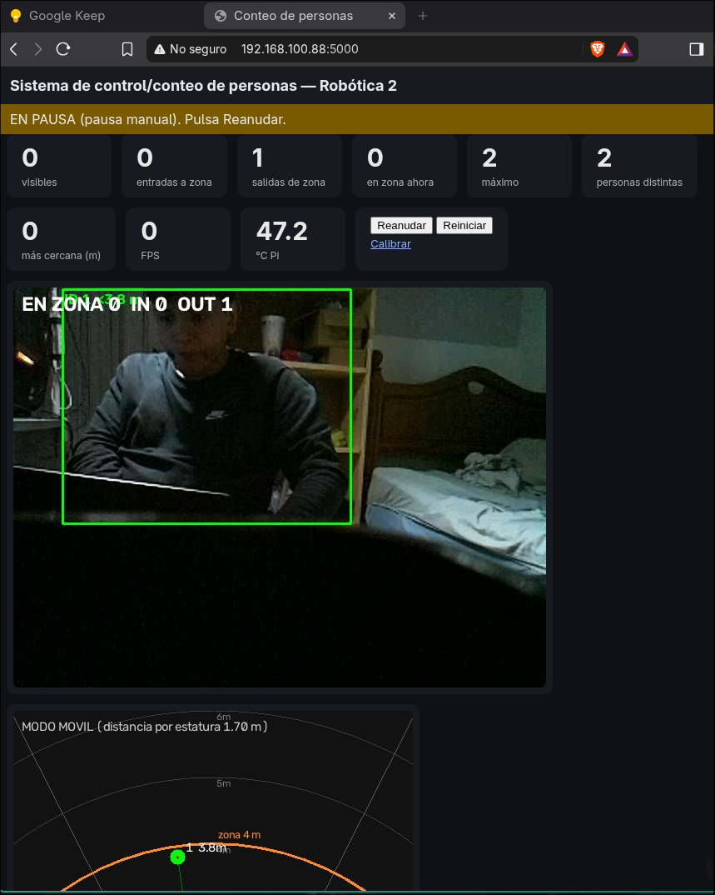
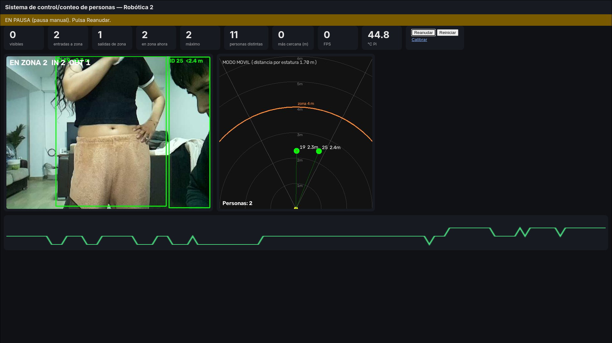
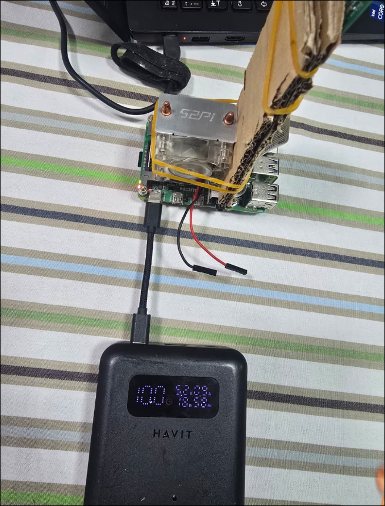

# 04 · Calibración y pruebas 📐

> El ingeniero exige que **funcione y sea preciso**. Aquí se **mide**, no se asume.

El sistema usa el modo **`mobile`** (zona circular de 4 m alrededor de la cámara; distancia por altura de caja). El modo `fixed` (línea de puerta + homografía) se describe al final como alternativa.

---

## 1. Instalación física de la cámara
| Parámetro | Valor usado |
|---|---|
| Altura de la cámara | ≈ 95 cm |
| Inclinación | Hacia el frente, viendo a las personas de pie |
| Campo de visión | ≈ 54° horizontal, ≈ 41° vertical |
| Estabilidad | Cámara fija (no se mueve entre calibrar y usar) |

**Regla clave:** para que una persona de ~1.70 m se vea **de cuerpo completo** a esa altura, debe estar a **más de ~2.5 m**. Más cerca sale cortada: la caja es más corta y la distancia se sobreestima (por eso el dashboard pone `<` delante).

---

## 2. ¿Cómo se calcula la distancia?

```
            K                  K = distancia(m) × altura_de_la_caja(px)
 Z (m) = ─────────────
         altura_caja(px)
```
- **`K` teórico** = focal(628 px) × 1.70 m = **1067**.
- **Resultado real:** a 3 m, persona de **1.63 m**, la caja medía **≈ 347 px** (25 muestras, rango 346–348).

| Cálculo | Resultado |
|---|---|
| Distancia con K teórico | 1067 / 347 = **3.08 m** |
| Error | +0.08 m = **+2.5 %** ✅ |
| K medido (3 × 347) | **1041** |
| Focal efectiva (1041 / 1.63) | **639 px** (la teórica es 628 → coincide, la cámara y el FOV de 54° están bien) |

**Por qué da bien aunque ella mide 1.63 y no 1.70:** el error del FOV (focal) y el de la estatura casi se compensan. No hay que confiar en esa casualidad: por eso se pide probar a otras distancias y con otras personas.

### Efecto de la estatura
La fórmula supone **1.70 m**. Para otra persona el error es proporcional a la diferencia:

| Estatura real | Error esperado |
|---|---|
| 1.55 m | −9 % (parece más cerca) |
| 1.63 m | −4 % (medido: +2.5 %, por la compensación de arriba) |
| 1.70 m | 0 % |
| 1.85 m | +9 % (parece más lejos) |

---

## 3. Procedimiento de calibración de la distancia (con la página web)

1. Abre `http://pi-conteo.local:5000/calibrate`.
2. Mide con **cinta métrica** desde la cámara hacia el frente y marca el piso a **3 m, 4 m y 5 m**.
3. Una persona de estatura **promedio**, de pie y **de cuerpo completo**, se para en los 3 m.
4. Escribe `3` en el recuadro y pulsa **Medir** (3 s, quieta). Aparece:
   `3 m → caja 347 px → K=1041 (con K actual: 3.08 m)`
5. Repite en 4 m y 5 m.
6. Pulsa **Guardar K**. Se usa un ajuste por mínimos cuadrados con todos los puntos y se guarda en `src/dist_calib.json`. Se aplica **sin reiniciar**.
7. **Verifica** con distancias distintas (2.5, 3.5, 4.5 m) y completa la tabla del punto 5.
8. **Volver a teórica** borra la calibración.

---

## 4. Pruebas de conteo (llenar la tabla)

El modo móvil cuenta **cruces del círculo de 4 m**. Antes de cada prueba pulsa **Reiniciar conteo**. Un compañero cuenta a mano.

| # | Escenario | Real IN | Real OUT | Sistema IN | Sistema OUT | Acierto |
|---|---|---|---|---|---|---|
| 1 | 1 persona entra y sale 5 veces, caminando normal | 5 | 5 | | | |
| 2 | 1 persona, cruces rápidos | | | | | |
| 3 | 2 personas entran juntas | 2 | 0 | | | |
| 4 | 2 personas, una entra y otra sale | 1 | 1 | | | |
| 5 | Grupo de 3–5 | | | | | |
| 6 | Poca luz / mucha luz | | | | | |

**Acierto = 1 − |real − sistema| / real.** Meta: **≥ 95 %**.
Las evidencias quedan en `~/conteo/logs/eventos_*.csv` (copiar con `scp`, ver doc 03).

---

## 5. Pruebas de distancia (sistema vs cinta métrica)

Anota la distancia que muestra "Personas ahora mismo" y compárala con la cinta. Usa **varias personas**.

| Persona (estatura) | Distancia real (m) | Medida del sistema (m) | Error (m) | Error (%) |
|---|---|---|---|---|
| Amiga (1.63 m) | 3.0 | 3.08 | +0.08 | +2.5 % |
| | 2.5 | | | |
| | 3.5 | | | |
| | 4.0 | | | |
| | 4.5 | | | |

**Error (%) = (medida − real) / real × 100.** Meta: **< 10–15 %**.

---

## 6. Pruebas de estabilidad
| Prueba | Cómo | Resultado |
|---|---|---|
| 30 min continuos | Dejarlo corriendo; mirar `top` y `free -m` | |
| FPS | Se ve en el dashboard | medido: ≈ 5.5 – 6.8 |
| Temperatura | `vcgencmd measure_temp` | medido: 47 – 65 °C |
| Energía | `vcgencmd get_throttled` | medido: `0x0` ✅ |
| Reconexión de cámara | Desconectar y reconectar | |
| Retraso de red | `ping -c 10 pi-conteo.local` | hotspot: ≈ 17 ms promedio |

---

## 7. Si algo falla (qué ajustar en `src/config.py`)
| Síntoma | Ajuste |
|---|---|
| Cuenta doble al borde | subir `ZONE_HYST_M` (0.4 → 0.6) o `MIN_TRACK_FRAMES` |
| No cuenta a gente rápida | `FRAME_SKIP = 1`, bajar `IMGSZ` a 320 |
| Falsos positivos (sillas, etc.) | subir `CONF` a 0.55 y `MIN_BOX_H` |
| Pierde personas | bajar `CONF` a 0.35, mejorar luz/ángulo |
| Distancia siempre mayor | persona cortada o muy cerca; alejarse; recalibrar K |
| Distancia siempre menor | persona más alta que 1.70 m; recalibrar K |
| Aforo | cambiar `MAX_CAPACITY` |

Después de editar: copiar a la Pi y `sudo systemctl restart conteo` (ver doc 02, sección "Cómo actualizar el código").

---

## 8. Imágenes de prueba (evidencia)

**Problema detectado y explicado:** una persona *sentada y cortada* da una distancia errónea (3.8 m cuando está a ~1 m), porque el método asume una persona de pie y de cuerpo completo.


**Pruebas con dos personas** (versión anterior de la interfaz):


**Raspberry Pi alimentada con la powerbank** (5 V / 3 A):


---

## 9. Alternativa: modo `fixed` (línea de puerta + homografía)
Para una cámara fija en un paso. Se activa con `PC_MODE=fixed` y se calibra con 4 puntos del piso en `/calibrate` → sección "Calibración del piso". Se explica en el doc 01 (sección 5).
